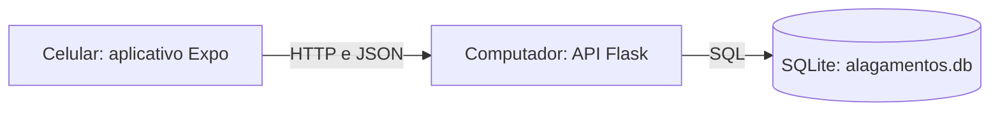

# Alerta de Alagamentos

Protótipo acadêmico para **registrar e consultar relatos de alagamentos urbanos**. As informações são fornecidas pelos participantes: **não são alertas oficiais nem ocorrências verificadas**.

O aplicativo tem três telas: **Ocorrências**, **Novo registro** e **Detalhes**. Permite cadastrar um relato, consultar os dados e marcar sua situação como resolvida. A API guarda os registros em SQLite no computador; o celular sempre acessa os dados pela API.

## Estrutura

```text
backend/          API em Python/Flask e banco SQLite
mobile/           Aplicativo em JavaScript/React Native com Expo
documentacao/     Contrato da API, conceitos, diagramas e roteiro de testes
```



## Preparar o computador

Instale Python 3.10 ou superior, Node.js LTS e Git. A versão de Node usada nos testes foi **24.22.1**, registrada em `mobile/.nvmrc`. Use um editor como VS Code. O projeto usa **Expo SDK 57** (`expo ~57.0.32`), **React 19.2.3** e **React Native 0.86.3**, a partir do template oficial blank. No Android, instale Expo Go e confira a compatibilidade com esse SDK em [expo.dev/go](https://expo.dev/go). O arquivo de dependências e o lockfile definem a combinação usada pelo projeto; não atualize pacotes aleatoriamente para corrigir incompatibilidades.

Abra esta pasta no terminal. Os comandos abaixo usam dois terminais: um para a API e outro para o Expo.

### 1. API no Windows — Prompt de Comando (CMD)

```bat
py --version
node --version
npm --version
git --version

cd backend
py -m venv .venv
.venv\Scripts\activate.bat
python -m pip install -r requirements.txt
python -m flask --app app run
```

No navegador do computador, acesse `http://127.0.0.1:5000/saude`. A resposta deve ser `{"status":"ok"}`. Pare a API com **Ctrl+C** antes de inicializar o banco:

```bat
python init_db.py
python -m flask --app app run --host=0.0.0.0 --port=5000
```

Se `py` não existir e `python --version` funcionar, substitua `py` por `python`. O inicializador cria `backend/alagamentos.db` e mantém os registros existentes.

### API no Linux/macOS

Na raiz do repositório:

```sh
cd backend
python3 -m venv .venv
. .venv/bin/activate
python -m pip install -r requirements.txt
python -m flask --app app run
```

Confira `/saude`, pare com **Ctrl+C** e execute:

```sh
python init_db.py
python -m flask --app app run --host=0.0.0.0 --port=5000
```

Mantenha o modo de depuração desativado ao acessar pela rede. O servidor do Flask atende ao desenvolvimento e à demonstração local; esta configuração não é uma publicação em produção.

No ambiente Linux da nuvem, `bash scripts/configurar_nuvem.sh`, executado na raiz, reproduz a instalação da API e do aplicativo e inicializa o banco sem apagar registros. Esse script prepara as dependências; a API e o Expo continuam exigindo seus próprios comandos de inicialização. Para uso pessoal no computador, siga as etapas específicas do seu sistema acima.

### 2. Conectar o celular à API

1. Conecte computador e celular à mesma rede Wi-Fi.
2. Descubra o IPv4 do computador com `ipconfig` no Windows ou nas configurações de rede do Linux/macOS.
3. Abra `http://IP-DO-COMPUTADOR:5000/saude` no navegador do celular, usando o IP real.
4. Se não funcionar, verifique a rede, o endereço e a permissão do Python no firewall da rede privada. Não desative o firewall inteiro. Redes de convidados podem impedir a comunicação entre dispositivos.

`127.0.0.1` e `localhost` apontam para o próprio dispositivo. `0.0.0.0` é a configuração de escuta do servidor, não o endereço a colocar no aplicativo. Um ambiente na nuvem não está automaticamente na mesma rede Wi-Fi do celular: para a demonstração local, execute a API e o Expo no computador acessível pelos participantes.

### 3. Aplicativo móvel

Abra **outro terminal**, na raiz do repositório:

```sh
cd mobile
npm ci
```

Dentro de `mobile`, copie o exemplo sem sobrescrever uma configuração local que você já tenha. No Windows CMD:

```bat
copy .env.example .env
```

No Linux/macOS:

```sh
cp .env.example .env
```

Abra o arquivo `.env` criado e configure `EXPO_PUBLIC_API_URL` com o IPv4 real do computador:

```dotenv
EXPO_PUBLIC_API_URL=http://192.168.1.20:5000
```

O IP acima é fictício. O endereço da API fica centralizado em `mobile/src/config.js`. A variável é pública e não deve conter credenciais. Depois de alterar o endereço, reinicie o Expo para carregar a configuração:

```sh
npx expo start --lan --port 8081 --clear
```

Abra o Expo Go e escaneie o QR Code. Confira se o endereço mostrado pelo Expo usa o IPv4 LAN do computador e a porta `8081`. O formato escolhido para a demonstração é **Expo Go**. Mantenha os terminais da API e do Expo abertos: o Expo entrega o aplicativo em desenvolvimento e o Flask recebe as consultas e grava os relatos.

O celular precisa alcançar **dois serviços**: Python/Flask na porta `5000` e Node/Metro na `8081`. Se `/saude` abre, mas o QR Code não carrega o aplicativo, confira o endereço LAN do Expo e a permissão do Node no firewall **da rede privada**. A permissão do Python não libera automaticamente o Node. Não desative o firewall inteiro; redes de convidados também podem impedir essa comunicação.

## Usar o protótipo

1. Em **Ocorrências**, toque em **Nova ocorrência**.
2. Preencha bairro, endereço, descrição e gravidade. Salve.
3. A lista é consultada novamente após o cadastro.
4. Abra um relato para ver todos os campos e tocar em **Marcar como resolvido**.
5. No outro dispositivo, toque em **Atualizar** para consultar o estado salvo.

O identificador, a data de cadastro e a situação inicial `ativo` são definidos pelo servidor. A data é armazenada em UTC. Falhas no envio devem manter os campos preenchidos para permitir uma nova tentativa.

## Verificar o projeto

Com o ambiente virtual ativado:

```sh
cd backend
python -m unittest discover -s tests -v
```

Se já estiver em `backend`, execute apenas o segundo comando. Os testes usam banco temporário, separado do banco de demonstração.

No terminal móvel, dentro de `mobile`, verifique também o código da interface:

```sh
npm run lint
npm run typecheck
```

Opcionalmente, `npm run web` permite inspecionar as telas no navegador do mesmo computador. Para esse teste local, a API aceita as origens `http://localhost:8081` e `http://127.0.0.1:8081`; o cliente web usa `http://127.0.0.1:5000` quando a variável de endereço não está definida. Esse teste auxilia o desenvolvimento, mas a entrega móvel deve ser conferida no Expo Go.

Consulte [o roteiro e o registro de validação](documentacao/TESTES.md) para o teste integrado opcional com Playwright e os testes de persistência, rede, indisponibilidade e demonstração com dois dispositivos. Testes automatizados locais não substituem o teste em celulares físicos.

## Limitações da primeira versão

- Não há login: qualquer participante com acesso à API pode alterar a situação de um relato. Esta é uma limitação acadêmica do protótipo.
- Os relatos não recebem verificação de uma autoridade. Gravidade e situação refletem o que os participantes informam.
- A atualização é manual ao consultar novamente. Não há sincronização em tempo real.
- Existe uma API e um arquivo de banco no servidor. SQLite não está distribuído; o projeto não implementa replicação ou tolerância a falhas.
- A operação depende do computador e da rede disponíveis. Não há modo offline nem fila de envio.
- Login, mapas, fotos, GPS e notificações ficam fora desta versão.

## Documentação

- [Checklist das próximas etapas e da entrega](documentacao/ENTREGA.md)
- [Roteiro de apresentação de 5 a 8 minutos](documentacao/APRESENTACAO.md)
- [Base do relatório para revisão e preenchimento pelo grupo](documentacao/RELATORIO_BASE.md)
- [Vídeos e capturas da demonstração de apoio web](documentacao/evidencias/index.html)
- [Contrato da API](documentacao/API.md)
- [Arquitetura, conceitos e diagramas preparatórios](documentacao/ARQUITETURA.md)
- [Roteiro de testes e demonstração](documentacao/TESTES.md)
- [Modelo de diário de atividades e fontes](documentacao/DIARIO.md)
- [Instruções locais e situação da configuração da nuvem](documentacao/AMBIENTE_NUVEM.md)

O banco fica fora do Git. Para preservar os dados de demonstração, pare a API e faça uma cópia separada de `backend/alagamentos.db`. Não apague esse arquivo ao reiniciar o servidor.
