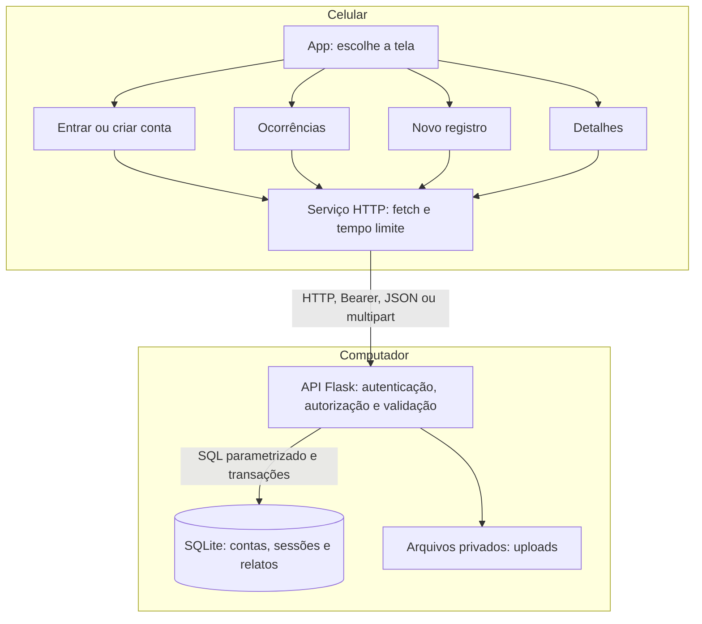
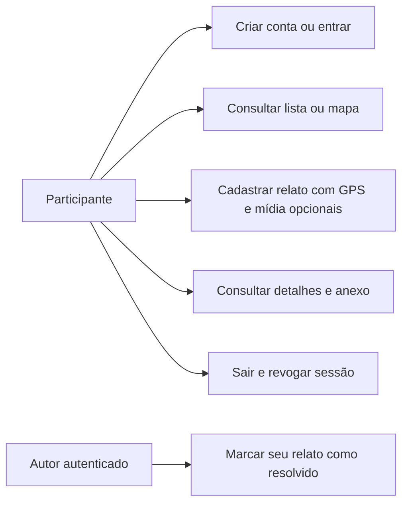
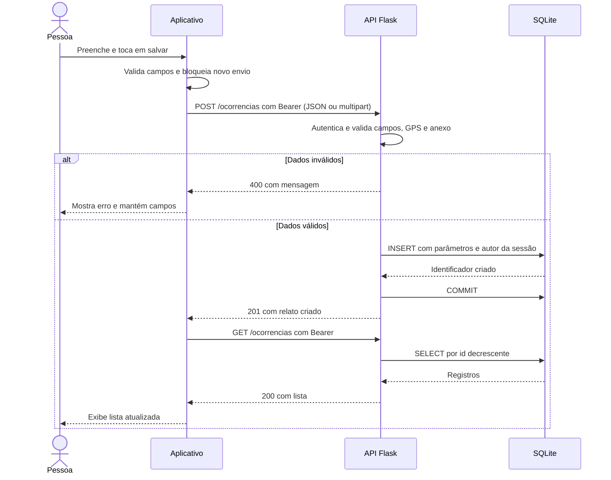
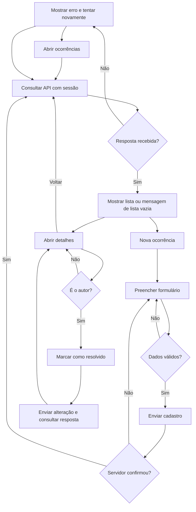

# Arquitetura e conceitos

O sistema tem um aplicativo móvel com autenticação, uma API, um banco SQLite e arquivos de mídia no servidor. A comunicação entre processos em dispositivos distintos caracteriza o estudo cliente-servidor. O banco e os anexos permanecem centralizados no computador.

| Conceito | Aplicação neste projeto |
| --- | --- |
| Cliente-servidor | O celular solicita operações; a API processa e responde |
| HTTP | Transporta consultas e alterações com métodos, endereços e códigos de resposta |
| JSON | Representa os campos enviados e recebidos |
| API | Define as operações disponíveis e suas regras de validação |
| Persistência | O SQLite mantém registros após fechar e reabrir a API |
| Falha parcial | O aplicativo pode abrir mesmo quando a API está indisponível; as consultas falham e a tela permite tentar novamente |
| Concorrência | Mais de um cliente pode enviar pedidos; o SQLite coordena as gravações no mesmo arquivo |
| Atualização manual | Um dispositivo vê as alterações de outro ao consultar novamente |
| Autenticação | Um token de sessão identifica uma conta nos pedidos à API |
| Autorização | A API verifica a autoria antes de permitir alterar a situação |
| Localização opcional | O participante pode compartilhar as coordenadas obtidas em primeiro plano |

SQLite admite várias leituras, mas serializa gravações: ter vários clientes não torna o banco distribuído nem garante capacidade ilimitada. A API abre e fecha conexões por operação e confirma transações antes de informar sucesso. Valores do usuário são passados como parâmetros SQL; não são concatenados no comando.

Não há fila offline, replicação, balanceamento ou tolerância a falhas. Se a API, o computador ou a rede ficar indisponível, o fluxo depende de restabelecer o serviço. O login identifica a conta, mas não verifica a veracidade do relato nem a identidade civil do participante.

## Sessão e autoria

O cadastro cria uma conta e uma sessão. O login confere a senha e emite um token aleatório. A API armazena o hash da senha com scrypt e somente o hash SHA-256 do token. O cliente envia o token no cabeçalho `Authorization: Bearer ...`; a sessão expira em até sete dias e o logout a revoga no servidor.

No aplicativo nativo, SecureStore conserva o token. Na versão web, o token fica em memória, sem persistência no armazenamento do navegador: recarregar a página exige entrar novamente. Uma falha de rede durante a restauração permite tentar novamente sem apagar automaticamente o token válido.

Consultar relatos ou anexos exige autenticação. Somente o autor pode alterar a situação de seu relato. A interface apresenta essa permissão, mas é a API que a garante. Os registros da primeira versão são migrados com autor ausente e preservados para consulta, sem atribuição automática a usuários novos e sem alteração de situação.

## Localização, mapas e anexos

A localização é opcional. O aplicativo solicita permissão somente quando o participante toca na ação de obter a posição e utiliza o GPS em primeiro plano. Negar a permissão permite continuar sem coordenadas. Não há coleta contínua nem rastreamento em segundo plano. A API aceita latitude e longitude juntas, valida seus intervalos e as disponibiliza aos participantes autenticados junto ao relato.

O mapa nativo utiliza `react-native-maps` compatível com Expo Go, com provedor Google no Android e Apple no iOS. A interface web usa Leaflet e mosaicos do OpenStreetMap, mantendo a atribuição. O carregamento dos mapas depende de serviços externos e da Internet. Geolocalização no navegador exige contexto seguro: HTTPS ou localhost. HTTP pelo IP da rede pode impedir o GPS na web; essa regra não descreve o funcionamento nativo do Expo Go.

O cadastro aceita um único anexo opcional: imagem JPEG/PNG ou vídeo MP4 de até 20 MiB. A API valida o conteúdo, reprocessa imagens com Pillow removendo EXIF e registra a associação entre arquivo e ocorrência. O limite de tamanho não define duração máxima para vídeo. O cadastro com arquivo é enviado como multipart, mantendo relato e anexo na mesma operação: uma falha não deve deixar um relato cadastrado pela metade.

Os arquivos ficam em `backend/uploads/`, sem exposição como pasta pública. A rota de leitura exige autenticação. Para fazer backup consistente, pare a API e copie o banco e os uploads juntos. Não há verificação oficial dos relatos nem moderação dos anexos.

## Componentes

## Casos de uso

Contas autenticadas consultam os relatos. A autoria limita a alteração de situação: outro participante não pode resolver o relato de alguém. Não há papel de administrador ou moderador. O aplicativo não valida a veracidade dos relatos nem emite um alerta oficial.

## Sequência de cadastro

Se ocorrer falha de gravação, a API desfaz a transação ainda não confirmada, registra o detalhe técnico no terminal e responde com erro. Uma falha de rede depois da gravação pode deixar o cliente sem a confirmação: consulte a lista antes de repetir o cadastro para evitar um relato duplicado. O protótipo não implementa chaves de idempotência.

## Fluxo de atividades

## Modelo do banco

O modelo atual guarda contas, sessões, relatos e os metadados dos anexos:

```mermaid
erDiagram
    usuarios ||--o{ sessoes : possui
    usuarios o|--o{ ocorrencias : autoria
    ocorrencias ||--o| anexos : possui
    usuarios {
        INTEGER id PK
        TEXT nome
        TEXT email UK
        TEXT senha_hash
    }
    sessoes {
        INTEGER id PK
        INTEGER usuario_id FK
        TEXT token_hash UK
        TEXT expira_em
    }
    ocorrencias {
        INTEGER id PK
        TEXT bairro
        TEXT endereco
        TEXT descricao
        TEXT gravidade
        TEXT situacao
        TEXT criado_em
        INTEGER autor_id FK
        REAL latitude
        REAL longitude
    }
    anexos {
        INTEGER id PK
        INTEGER ocorrencia_id FK
        TEXT nome_arquivo UK
        TEXT tipo
        TEXT mime_type
        INTEGER tamanho
    }
```

Os textos do relato são obrigatórios. `gravidade` aceita `baixa`, `media` e `alta`. `situacao` aceita `ativo` e `resolvido`, com padrão `ativo`. O servidor preenche a data e a autoria. As coordenadas são opcionais e devem existir em par. `NOT NULL` evita nulos nos campos exigidos; a validação da API também rejeita textos vazios. O inicializador preserva dados existentes e migra a estrutura da primeira versão. Relatos antigos ficam com `autor_id` nulo.

Estes diagramas são preparatórios. O grupo deve confirmar com o professor quais quatro diagramas são exigidos e ajustar a apresentação à notação solicitada. Não acrescentar funções que o programa não implementa para preencher o relatório.
