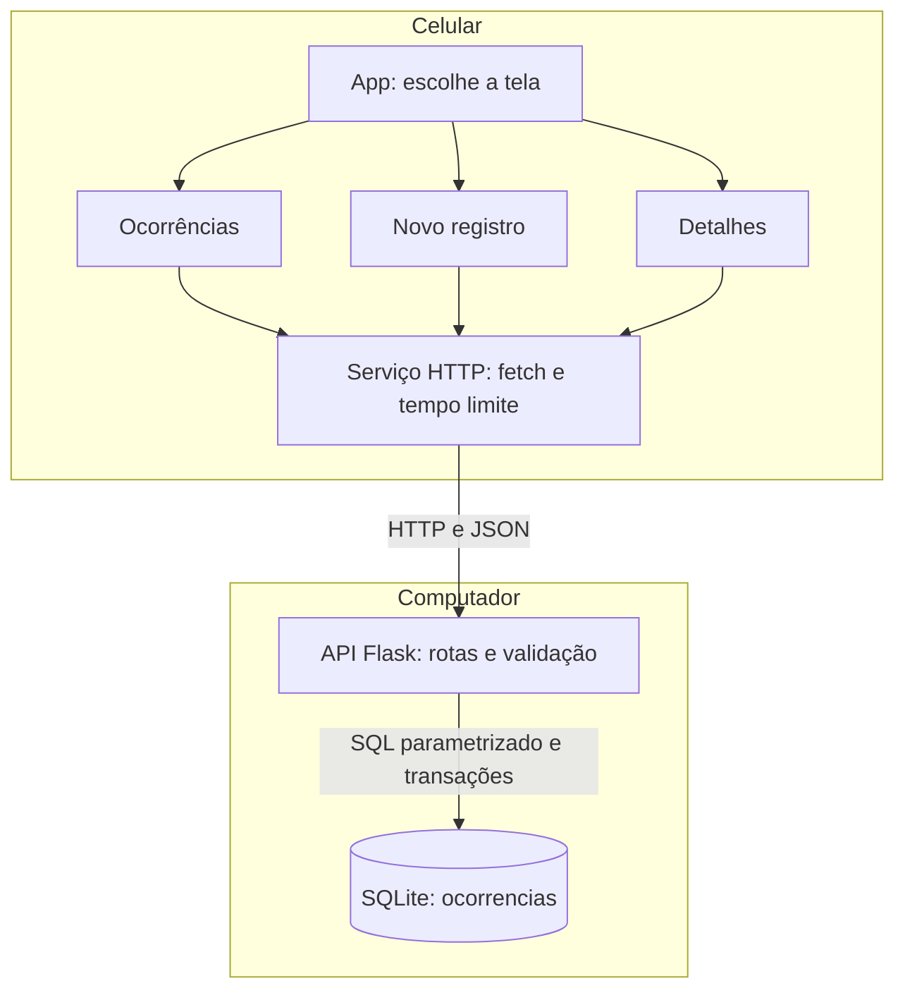
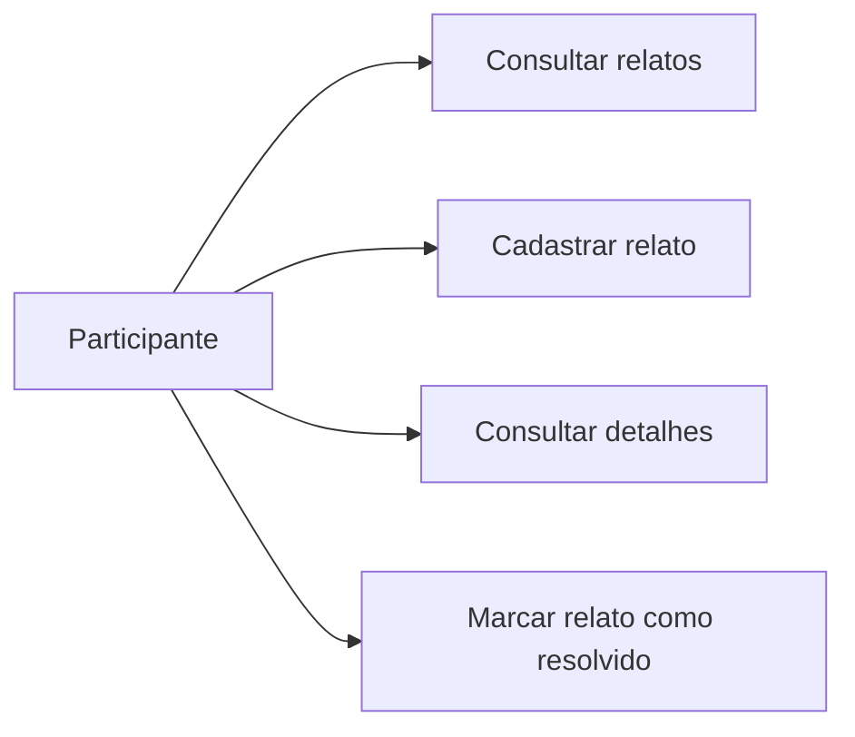
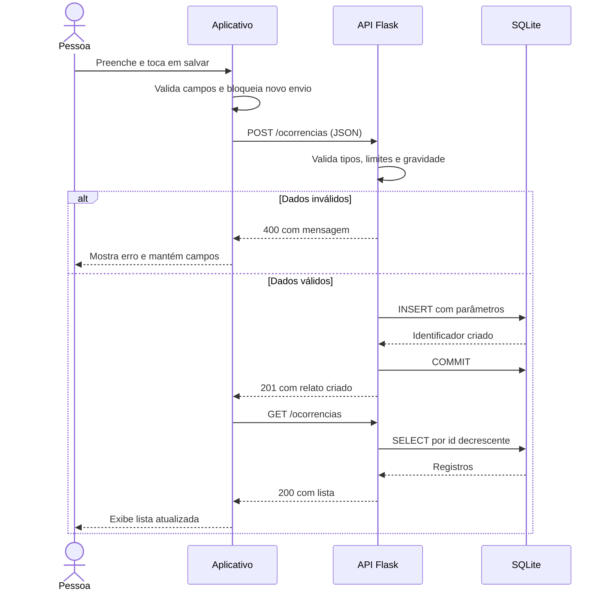
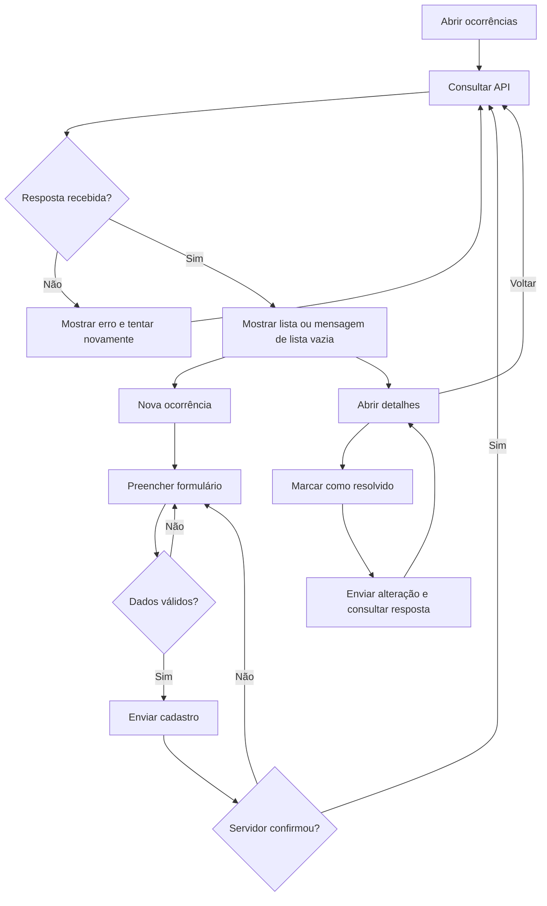
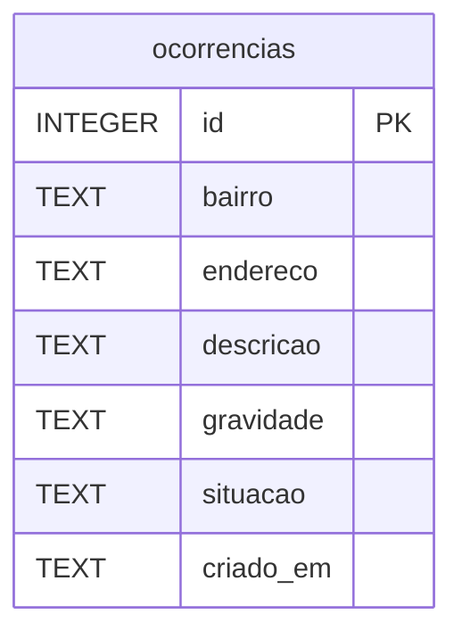

# Arquitetura e conceitos

O sistema tem um aplicativo móvel, uma API e um banco em arquivo. A comunicação entre processos em dispositivos distintos caracteriza o estudo cliente-servidor. O banco permanece centralizado no computador.

| Conceito | Aplicação neste projeto |
| --- | --- |
| Cliente-servidor | O celular solicita operações; a API processa e responde |
| HTTP | Transporta consultas e alterações com métodos, endereços e códigos de resposta |
| JSON | Representa os campos enviados e recebidos |
| API | Define as operações disponíveis e suas regras de validação |
| Persistência | O SQLite mantém registros após fechar e reabrir a API |
| Falha parcial | O aplicativo pode abrir mesmo quando a API está indisponível; as consultas falham e a tela permite tentar novamente |
| Concorrência | Mais de um cliente pode enviar pedidos; o SQLite coordena as gravações no mesmo arquivo |
| Atualização manual | Um dispositivo vê as alterações de outro ao consultar novamente |

SQLite admite várias leituras, mas serializa gravações: ter vários clientes não torna o banco distribuído nem garante capacidade ilimitada. A API abre e fecha conexões por operação e confirma transações antes de informar sucesso. Valores do usuário são passados como parâmetros SQL; não são concatenados no comando.

Não há fila offline, replicação, balanceamento ou tolerância a falhas. Se a API, o computador ou a rede ficar indisponível, o fluxo depende de restabelecer o serviço. Sem login, qualquer participante com acesso à API pode atualizar a situação. Essa limitação deve constar na apresentação.

## Componentes

## Casos de uso

Existe um único papel de participante, pois a primeira versão não tem autenticação. O aplicativo não valida a veracidade dos relatos nem emite um alerta oficial.

## Sequência de cadastro

Se ocorrer falha de gravação, a API desfaz a transação ainda não confirmada, registra o detalhe técnico no terminal e responde com erro. Uma falha de rede depois da gravação pode deixar o cliente sem a confirmação: consulte a lista antes de repetir o cadastro para evitar um relato duplicado. O protótipo não implementa chaves de idempotência.

## Fluxo de atividades

## Modelo do banco

Uma tabela é suficiente para o escopo atual:

Todos os campos de conteúdo são obrigatórios. `gravidade` aceita `baixa`, `media` e `alta`. `situacao` aceita `ativo` e `resolvido`, com padrão `ativo`. O servidor preenche a data. `NOT NULL` evita nulos; a validação da API também rejeita textos vazios. `CREATE TABLE IF NOT EXISTS` permite executar o inicializador novamente sem apagar dados.

Estes diagramas são preparatórios. O grupo deve confirmar com o professor quais quatro diagramas são exigidos e ajustar a apresentação à notação solicitada. Não acrescentar funções que o programa não implementa para preencher o relatório.
